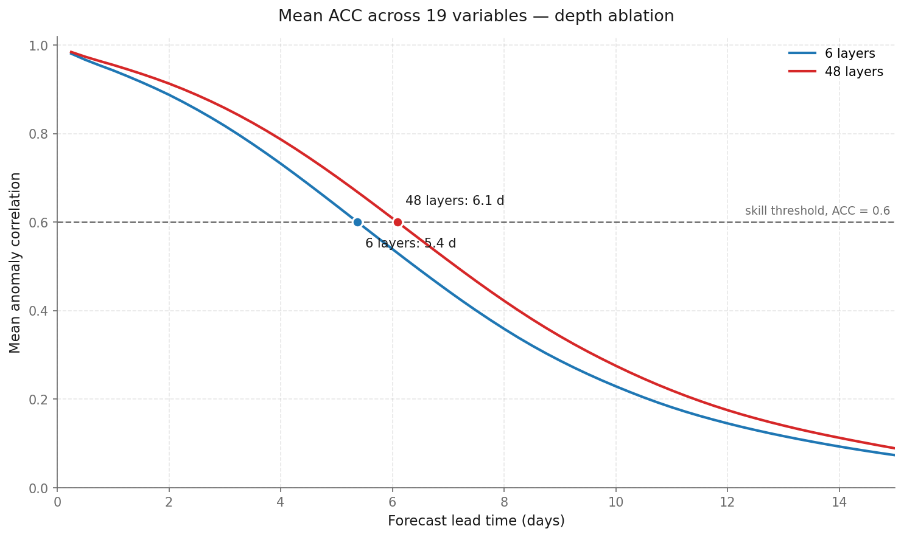
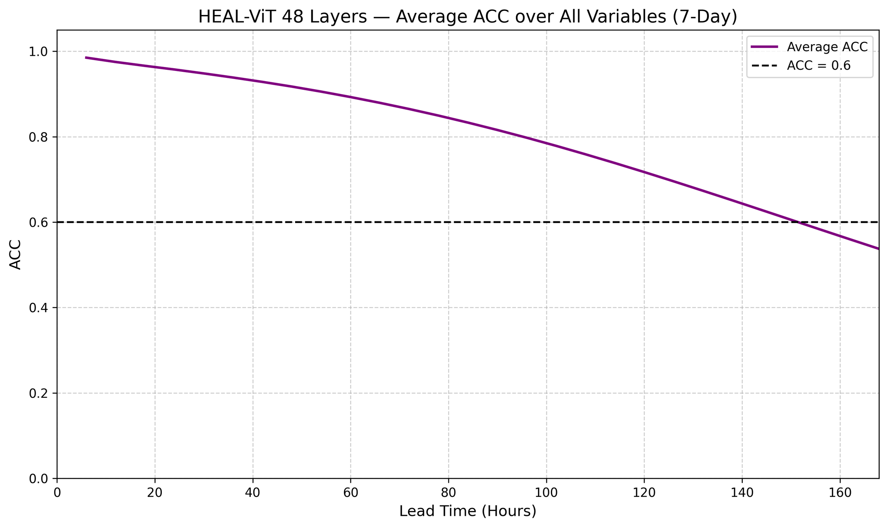
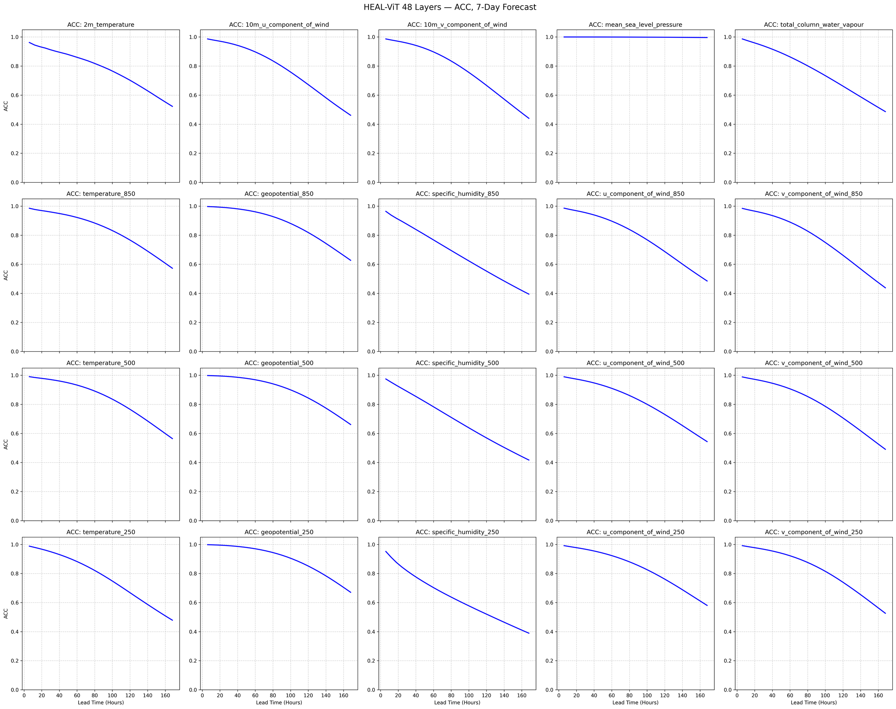
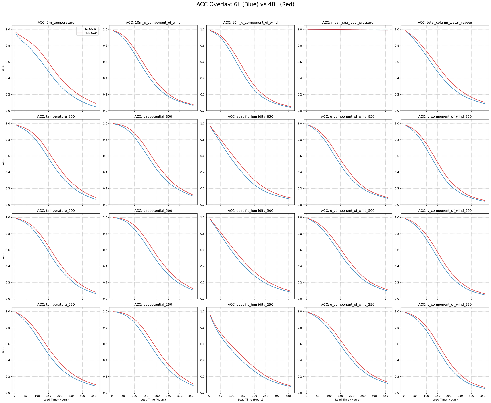
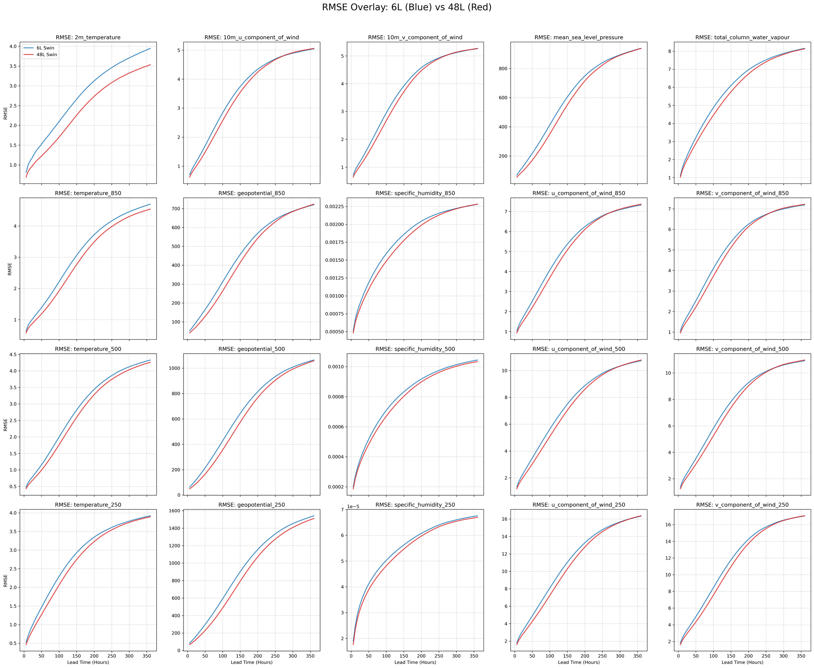
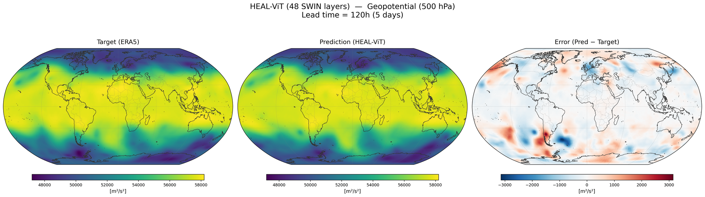
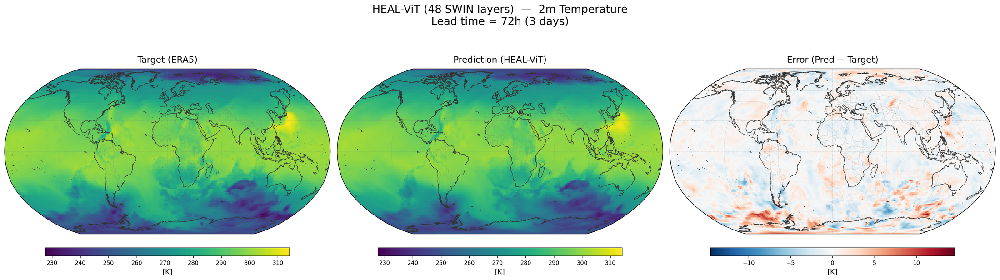
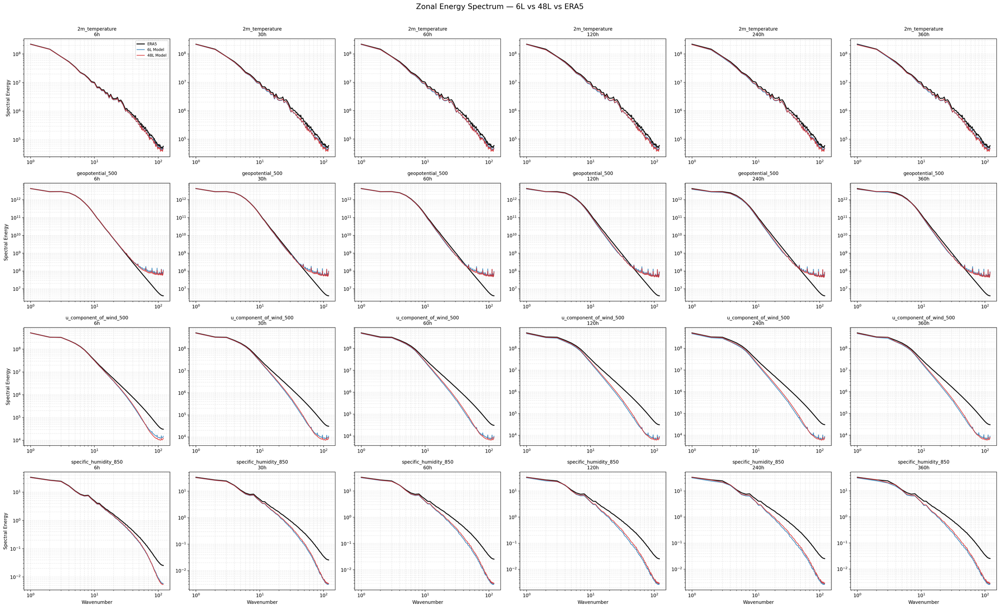
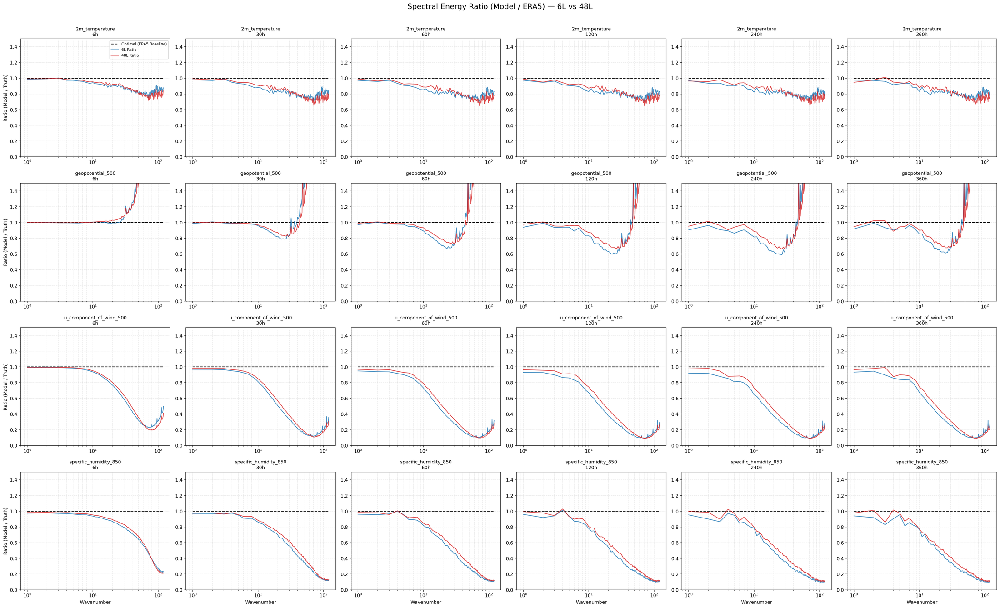

# HEAL-ViT — a 48-layer spherical transformer for global weather forecasting

[](https://www.python.org/)
[](https://pytorch.org/)
[](https://weatherbench2.readthedocs.io/)
[](LICENSE)

A data-driven global weather model that forecasts **20 atmospheric variables at 6-hourly
resolution** on the full 121 × 240 ERA5 grid. It combines a **HEALPix icosahedral mesh** —
which gives every node an equal-area patch of the sphere, with no pole singularity — with a
**shifted-window vision transformer** operating directly on that mesh. Graph neural network
blocks move information between the lat-lon grid and two mesh resolutions; 48 transformer
layers do the forecasting work in between.

Trained on **40 years of ERA5** (1979–2018) and evaluated on held-out **2019–2020**,
the model stays skilful (ACC > 0.6) out to **7.5 days for 500 hPa geopotential**
and remains numerically stable through a **60-step / 15-day** autoregressive rollout.

<p align="center">
  <br>
  <em>Mean anomaly correlation against lead time — the 48-layer model (this repo) against an
  otherwise identical 6-layer ablation. Averaged over 19 variables; MSLP is excluded for the
  reason given under <a href="#known-issues">Known issues</a>.</em>
</p>

---

## Headline results

Held-out 2019–2020, autoregressive rollout from the `ar6` checkpoint. RMSE is
latitude-weighted and in physical units; ACC is latitude-weighted anomaly correlation
against the WeatherBench 2 1990–2019 hourly climatology.

| Variable | ACC 1 d | ACC 3 d | ACC 5 d | ACC 7 d | Skill horizon (ACC > 0.6) | RMSE 3 d |
|---|---|---|---|---|---|---|
| Geopotential 500 hPa | 0.994 | 0.954 | 0.844 | 0.661 | **7.50 d** | 242 m²/s² |
| Geopotential 250 hPa | 0.994 | 0.956 | 0.851 | 0.671 | **7.50 d** | 333 m²/s² |
| Geopotential 850 hPa | 0.991 | 0.943 | 0.818 | 0.627 | 7.25 d | 183 m²/s² |
| u-wind 250 hPa | 0.974 | 0.899 | 0.761 | 0.580 | 6.75 d | 5.52 m/s |
| Temperature 850 hPa | 0.966 | 0.901 | 0.767 | 0.573 | 6.50 d | 1.48 K |
| Temperature 500 hPa | 0.976 | 0.910 | 0.766 | 0.564 | 6.50 d | 1.31 K |
| 2 m temperature | 0.924 | 0.837 | 0.702 | 0.522 | 6.00 d | 1.42 K |
| Total column water vapour | 0.951 | 0.827 | 0.662 | 0.486 | 5.50 d | 3.61 kg/m² |
| **Mean over 19 variables** | **0.955** | **0.858** | **0.702** | **0.513** | | |

Full per-variable tables for all 20 variables and all 60 lead times: **[docs/RESULTS.md](docs/RESULTS.md)**.

<p align="center">
  <br>
  <em>The operationally interesting window. Mean skill crosses the 0.6 threshold at
  6.1 days; individual variables range from 3.75 d (250 hPa specific humidity) to
  7.5 d (500 and 250 hPa geopotential).</em>
</p>

<p align="center">
  <br>
  <em>All 20 variables individually, out to 7 days. Geopotential decays slowest, specific
  humidity fastest — the expected ordering, since moisture is governed by small-scale
  processes the mesh cannot resolve.</em>
</p>

### Depth pays off: 48 layers vs 6 layers

Same data, same graph, same optimiser and curriculum — only `num_bottleneck_layers` changes.
Deeper wins at every lead time, and the gap widens as the forecast runs out.

| Mean ACC (19 vars) | 1 day | 3 days | 5 days | 7 days |
|---|---|---|---|---|
| **48 layers** (53.2 M params) | **0.955** | **0.858** | **0.702** | **0.513** |
| 6 layers | 0.943 | 0.817 | 0.637 | 0.445 |
| Gain | +0.012 | +0.041 | **+0.065** | **+0.068** |

Z500 skill horizon moves from 6.75 d → **7.50 d**; 2 m temperature from 4.75 d → **6.00 d**.

<p align="center">
  <br>
  <em>ACC to 15 days, every variable, 48 layers in red against 6 layers in blue. The deeper
  model is ahead in all 20 panels — the gain is systematic, not a lucky variable or two.</em>
</p>

<p align="center">
  <br>
  <em>The same comparison in RMSE, physical units. The curves separate early and stay
  separated, so the depth advantage is not merely a slower saturation toward climatology.</em>
</p>

### Forecast fields

<p align="center">
  <br>
  <em>500 hPa geopotential at a 5-day lead: ERA5 truth, forecast, and error. The model keeps
  the planetary wave structure and Rossby wave phase; the error is concentrated in
  mid-latitude storm tracks.</em>
</p>

<p align="center">
  <br>
  <em>2 m temperature at a 3-day lead. Land–sea contrast and the continental cold pools are
  reproduced; residual error follows coastlines and orography, where the 121 × 240 grid
  limits how sharp a gradient the model can represent.</em>
</p>

### Spectral behaviour

Ratio of forecast to ERA5 zonal power — 1.0 means the forecast carries the same variance as
reality at that scale.

| Lead | 2 m temperature (synoptic / sub-synoptic) | u-wind 250 hPa |
|---|---|---|
| 6 h | 0.85 / 0.79 | 0.48 / 0.25 |
| 5 d | 0.79 / 0.74 | 0.23 / 0.16 |
| 15 d | 0.80 / 0.74 | 0.23 / 0.16 |

The model is **spectrally stable**: energy drops in the first few steps, then holds flat out
to 15 days rather than blurring toward the mean or blowing up — the usual failure mode for
autoregressive forecast models. It does under-represent sub-synoptic variance, the expected
consequence of training on an RMSE objective, most strongly for upper-level winds. See
[Known issues](#known-issues).

<p align="center">
  <br>
  <em>Zonal energy spectra on log–log axes — ERA5 in black, 48 layers in red, 6 layers in
  blue — for four representative variables across six lead times. Both models track ERA5
  closely at planetary and synoptic wavenumbers and fall away at the tail. Neither shows the
  runaway energy growth that destabilises autoregressive rollouts, which is what keeps the
  15-day forecast usable — though geopotential does carry excess power in the far tail
  (<a href="#known-issues">Known issues</a>).</em>
</p>

<p align="center">
  <br>
  <em>The same data as a ratio to ERA5, where 1.0 is perfect. This is the more honest view.
  The deeper model holds more energy at planetary wavenumbers (5–20) in every variable and at
  every lead time tested — it is not buying its lower RMSE by smoothing. At the sub-synoptic
  tail the picture is mixed and the ratio there is a poor guide, since ERA5's own power is
  very small.</em>
</p>

---

## Architecture

53.2 M parameters. Grid → mesh → deep spherical transformer → mesh → grid.

```
ERA5 grid  121 × 240 × 20 vars
    │
    │  Encoder: linear embed (20 → 128) + GNN message passing
    ▼
Fine HEALPix mesh   nside=64   49,152 nodes   dim 128
    │
    │  2 × window-attention ViT blocks  ──────────────────┐  skip
    │  Downsample GNN (128 → 256)                         │
    ▼                                                     │
Coarse HEALPix mesh  nside=32  12,288 nodes  dim 256      │
    │                                                     │
    │  48 × ViT blocks, window=64, 8 heads                │
    │  alternating spherical shifted windows              │
    │                                                     │
    │  Upsample GNN (256 → 128)                           │
    ▼                                                     │
Fine mesh ──── concat ◄──────────────────────────────────┘
    │
    │  2 × ViT blocks  →  Decoder GNN
    ▼
ERA5 grid  121 × 240 × 20 vars   (state at t + 6 h)
```

**What makes it spherical.** Standard SWIN shifts windows by rolling a rectangular image,
which tears at the poles and the date line. `SphericalShift` ([`Core/model.py`](Core/model.py))
instead precomputes each HEALPix pixel's neighbour in a fixed compass direction via
`healpy.get_all_neighbours` in nested ordering, and gathers along it. Windows shift along the
sphere itself, so attention windows on alternating layers overlap correctly everywhere — poles
included. The nested HEALPix index also makes coarsening exact: node `i` on the fine mesh maps
to node `i // 4` on the coarse mesh, no interpolation needed.

**Design choices worth noting**

- Equal-area mesh means no latitude-dependent resolution bias — the pole problem that forces
  rectangular models into heavy latitude weighting.
- Edge features are **learned embeddings** (`nn.Parameter` per edge), not hand-built geometric
  features, so the encoder/decoder learn their own grid↔mesh interpolation.
- Gradient checkpointing on every ViT and GNN block: 48 layers over 12 k nodes fit in a
  2-GPU budget.
- Pre-norm blocks with the attention and MLP branches both reading the *same* normalised
  input — a parallel residual that trains more stably at depth than the sequential form.

---

## Training

| | |
|---|---|
| Data | WeatherBench 2 ERA5, 6-hourly, 240 × 121 equiangular |
| Train / validation | 1979–2018 / 2019–2020 (strictly held out) |
| Variables | 5 surface + 5 upper-air × 3 levels (850 / 500 / 250 hPa) = 20 |
| Objective | Latitude-weighted RMSE on normalised fields |
| Optimiser | AdamW, β = (0.9, 0.95), weight decay 0.1 |
| Schedule | Cosine from 2.5e-4; constant 1e-7 for rollout fine-tuning |
| Batching | 1 per GPU × 4 gradient accumulation, fp16 AMP |
| Hardware | 2 × GPU, DDP via `torchrun`, SLURM |

**Curriculum.** Stage 1 trains single-step (6 h) prediction for 11 epochs. Stages 2–6 then
fine-tune the model on its own rollouts at 2, 3, 4, 5 and 6 autoregressive steps, one epoch
each, at a very low learning rate. This is what buys the 15-day stability: the model sees its
own error distribution during training instead of only ERA5 states. One checkpoint per stage
is written to `Checkpoints/healvit_wb2_ar{N}.pt`.

---

## Repository layout

```
Core/           model, HEALPix graph construction, metrics, checkpoint I/O
Data_Config/    config.yaml + loader, ERA5 zarr dataset, normalisation stats
Training/       DDP training loop, entry point, SLURM submission script
ACC_RMSE_Eval/  rollout evaluation, ACC, spatial bias maps, plotting
Power_Spectra/  zonal power spectra evaluation and plots
scripts/        regenerate docs/RESULTS.md from the metric dumps
results/        metric dumps this README is built from (JSON + CSV)
figures/        publication figures
Checkpoints/    trained weights, one per curriculum stage (not tracked — see below)
```

Checkpoints (3.6 GB) and the ERA5 cache are deliberately **not** in git. The `results/` JSON
dumps and `figures/` are, so every number and plot here is reproducible from the repo alone.

## Reproducing

```bash
# environment
conda create -p ./envs/Heal_vit python=3.11
conda activate ./envs/Heal_vit
pip install -r requirements.txt        # torch 2.6 + cu124, torch-geometric, healpy, zarr

# train (2 GPUs, DDP)
export PYTHONPATH="$(pwd)"
torchrun --nnodes=1 --nproc_per_node=2 Training/main.py --config Data_Config/config.yaml
# or on SLURM:  sbatch Training/heal_vit.sh

# evaluate a 60-step rollout over all 20 variables
cd ACC_RMSE_Eval && python evaluate_variables.py     # -> evaluate_metrics.json
cd ../Power_Spectra && python evaluate_spectra.py    # -> spectra_metrics.json

# rebuild the results tables in docs/
python scripts/summarize_results.py
```

Point `data.zarr_path` in [`Data_Config/config.yaml`](Data_Config/config.yaml) at your own
WeatherBench 2 copy, and the climatology path in the evaluation scripts at an ERA5 hourly
climatology. Depth is a one-line change: `model.num_bottleneck_layers`.

## Known issues

Stated plainly, because the numbers above should be read with them in mind.

1. **`mean_sea_level_pressure` ACC is not meaningful.** The climatology zarr in use carries
   `surface_pressure` but no MSLP field, and `load_climatology` silently falls back to it
   ([`Data_Config/data.py:49`](Data_Config/data.py)). Subtracting surface pressure from MSLP
   leaves a large static orographic offset present in both forecast and truth, which pushes
   the correlation to ~0.999 at every lead time. MSLP is therefore excluded from all reported
   means. Its **RMSE is unaffected** and is a valid number. Fix: source an MSLP climatology,
   or derive it, and remove the fallback.
2. **Sub-synoptic energy is damped**, most severely for 250 hPa winds (~20 % of ERA5 power at
   wavenumbers 60–120). This is the standard consequence of an RMSE objective and affects the
   realism of small-scale structure, not large-scale skill. A spectral or adversarial loss
   term would be the route to addressing it.
3. **Geopotential carries excess grid-scale energy.** At wavenumbers 60–120 the predicted
   Z500 spectrum sits roughly 7× above ERA5 at every lead time (worse in the 6-layer model,
   ~7.5×). ERA5's own power is very small there, so the absolute magnitude is minor and it
   does not destabilise the rollout, but the signature is consistent with grid-scale noise
   entering through the mesh→grid decoder. Worth a look at the `M2G` k=4 neighbour
   interpolation before trusting fine-scale geopotential structure.
4. **No operational baseline.** Skill is reported against climatology, not against IFS HRES or
   ERA5 persistence, so these numbers are not yet directly comparable to the WeatherBench 2
   leaderboard.
5. **Single validation split**, no ensemble or seed spread, so the 48L-vs-6L gap is a single
   paired comparison rather than a significance-tested result.

## Citation

```bibtex
@software{yellowbanana-dev_healvit_2026,
  author = {yellowbanana-dev},
  title  = {HEAL-ViT: A 48-layer HEALPix Shifted-Window Transformer for Global Weather Forecasting},
  year   = {2026},
  url    = {https://github.com/yellowbanana-dev/Heal_ViT-48-layers}
}
```

This is an independent implementation. The HEAL-ViT formulation — a HEALPix mesh paired with a
transformer backbone — follows the published HEAL-ViT proposal, and the graph encoder/decoder
wrapped around a mesh backbone follows the GraphCast design. Evaluation protocol and data
follow WeatherBench 2.

## License

MIT — see [LICENSE](LICENSE).
